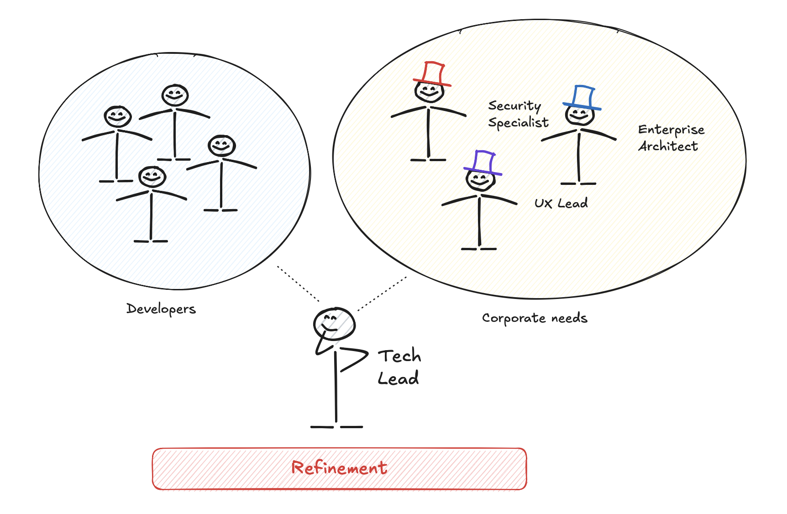

Have you ever asked a developer what a great technical leader does?

You will rarely hear that they want a "great architect" who designs the shiniest software architecture. They want a clear answer to what to work on next. Let me show you the two responsibilities that matter most.

Being a Tech Lead, Team Architect or any other kind of "most senior developer of a team" comes with lots of complexity. There are many different nuances and responsibilities to each specific role, whatever it is named. Yet two main responsibilities are shared by all kinds of Tech Leads:

1. **Keep the feature pipeline rolling**
2. **Build a technical vision**

## Keep the feature pipeline rolling

In software organizations, many ideas for new features and their technical solutions are floating around. Multiple stakeholders try to prioritize work for your team, and roadmaps shift regularly.

All of this happens while your team continuously needs well-prepared tasks to stay productive.

### Refinement is hard

In a perfect world, a coordinated flow of tasks always exists. The Product Owner aligns everyone on clear goals and provides a product roadmap for the next months. The team refines it into clear tasks and gets to work.

In reality, this comes with many impediments. Understanding, estimating and planning work in an organization with more than one team is complex. Many stakeholders are involved, and conflicts between business and tech come up regularly.

You have probably noticed it yourself: **refinement is one of the hardest parts of software development.**

### Prepare the work

Without a technical understanding of the current implementation, you cannot turn a roadmap idea into a clear task. The technical solution design must be outlined before anyone in a dev team starts to work.

This is where you as a Tech Lead fill the gap. You understand new features, align them with the architecture and resolve open questions early in the planning process.

In short: **a Tech Lead clarifies work before it reaches the developers.**

### Kill waste

Preparing work comes with one commitment to your team: **do not overrun them with waste.**

Changing requirements and details during implementation is not only inefficient. It also demotivates developers.

Mary and Tom Poppendieck already described this in their 2003 book [Lean Software Development](https://www.informit.com/store/lean-software-development-an-agile-toolkit-9780321150783). They list delays and partially done work among the seven wastes of software development. Your job is to clarify things early, so nobody has to change decisions late. Be the one who fosters a lean development process.

This is not only economically effective. It also feels better for everyone involved. So keep everyone happy and working on clear tasks based on coordinated and refined decisions.

## Build a technical vision

While the pipeline for new features flows smoothly, there are many non-functional architectural concerns that must be addressed to create long-lived software systems.

### Strive for technical clarity

A Tech Lead does not only drive the architecture of one product. They also align it with the organization-wide architecture.

In contrast to developers, who often want to build new and exciting technology, organization-wide architecture cares about long-lasting concerns first: security, UX or a shared tech stack. These things are shared organizational requirements and a common foundation.

Even if it is boring, you are the one who brings up the next Spring Boot application: **Be responsible and make it right**.

One of the main requirements of a Tech Lead is to bring a long-lived system to success. Software engineering is exactly about that: software that lasts and runs on a stable base, not just a simple vibe-coded script.

### How alignment works

Ready to follow all organizational rules, you ask: how hard can it be to follow organization-wide architecture? Maybe you read some documentation, make sure to apply the recommended way of doing things, and you will be fine, right?

Most likely, no!

Often there is no comprehensive documentation describing a solution, sometimes not a single document. Maybe there is merely someone to ask. And in the worst case, there is not even a process to follow.

**Knowing which setup to work with requires you to make your own way through the jungle**: something that requires tedious research and networking. Sometimes it is on you to bring up something new and align your organization on its usage.

### Own the team's technical wishlist

Besides organizational challenges, there are also technical requests driven directly by the developers in your team. Some are detailed technical issues, others are about developer experience, and those matter just as much.

You are probably familiar with requests like:

- Integrating code is too slow and the CI pipeline feels like it takes forever.
- The new event-driven architecture has no clear handling of API schemas.
- Our software should be rewritten in Rust ;)

There must be someone in the room who takes responsibility for such requests, even if some are more relevant than others. **Do not look for someone to solve technical challenges for you and your team**. It is the Tech Lead who tackles them.

These topics do not add features for users, but they keep the technology working in the short and the long run.

### Have a vision

A technical vision helps you make better decisions, gives your teammates a shared goal and brings organization and developers together. Communicate it thoroughly. Everyone writes better code when they know where they are heading and how to get there.

## Conclusion

Your team does not need the shiniest architecture from you. It needs two things: **a steady flow of clear, well-prepared tasks** and **a technical vision** that connects its daily work with the needs of the wider organization. Deliver both, and your developers can focus on what they do best: building software.